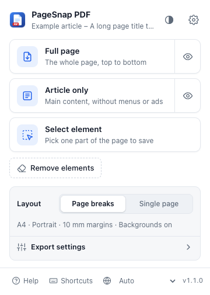
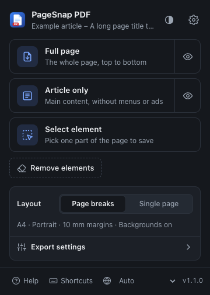
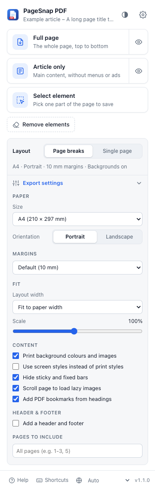
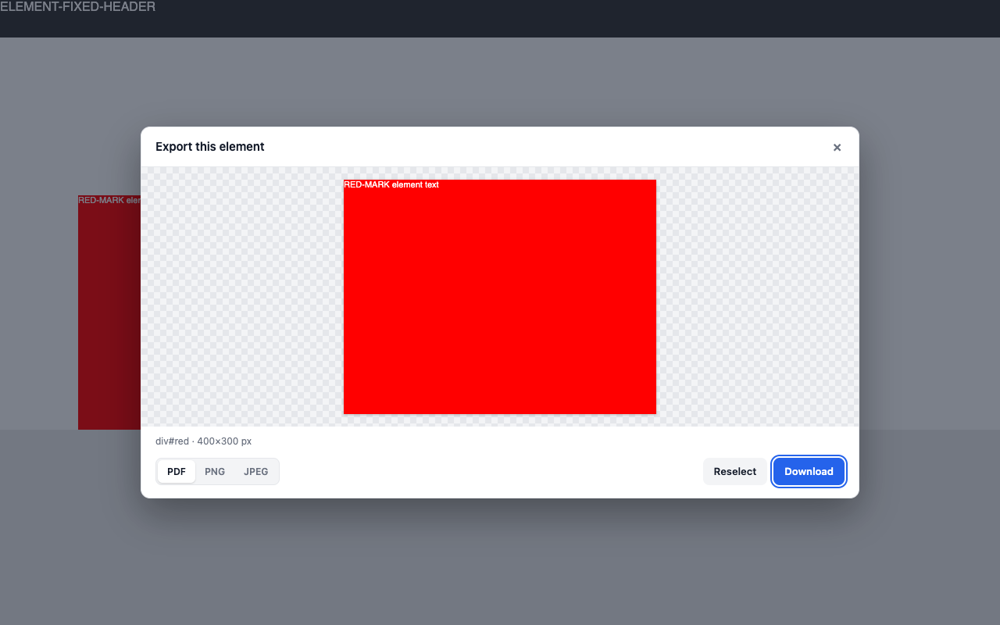
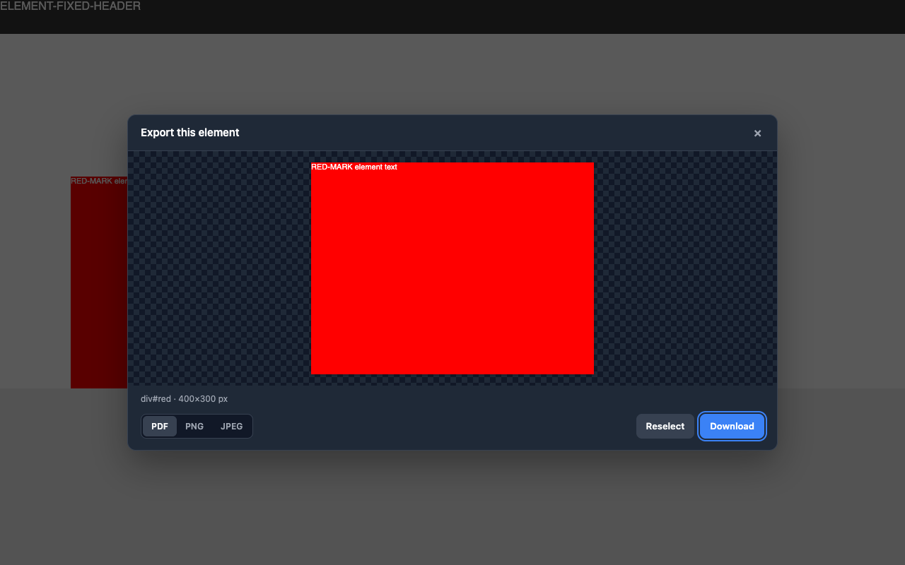
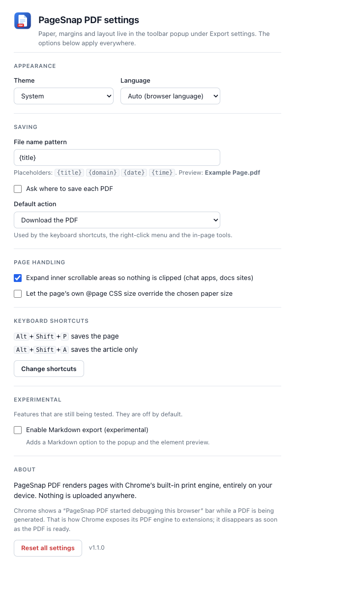
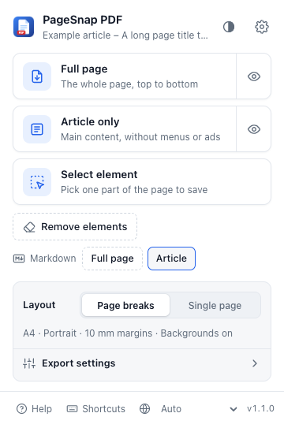

# PageSnap PDF

A Chrome extension (Manifest V3) that saves the current web page as a PDF in one click. It uses
Chrome's own print engine (`Page.printToPDF` through `chrome.debugger`), so styles and clickable
links are kept and nothing ever leaves your machine. A single element can also be saved as a PNG or
JPEG image, and pages can optionally be exported as Markdown (experimental).

PageSnap PDF is an independent, from-scratch implementation of the feature set of the "Web to PDF"
extension. It shares no code or branding with it, and everything is free: there is no account,
licence key or paid tier. MIT licensed (see [LICENSE](LICENSE)).

Requires Chrome 128 or newer (`minimum_chrome_version` in the manifest). Current version: 1.1.0.

## Features

### Compared with the original

"Same" means the feature exists here too; the implementation is our own. The comparison covers
only the features listed below; it is not a full audit of the original.

| Feature                                          | Status               | Notes                                                                             |
| ------------------------------------------------ | -------------------- | --------------------------------------------------------------------------------- |
| One-click save of the current page               | Same                 | Popup card, context menu, `Alt+Shift+P`                                           |
| Chrome's native PDF engine, runs locally         | Same                 | `chrome.debugger` + `Page.printToPDF`                                             |
| Keeps styles and clickable links                 | Same                 | Links become PDF link annotations                                                 |
| Paged or single-page layout                      | Same                 | Single page is one tall page, capped at 200 in                                    |
| 22 paper formats                                 | Same                 | A0-A9, B0-B5, Letter, Legal, Tabloid, Ledger, Folio, Executive                    |
| Portrait / landscape                             | Same                 |                                                                                   |
| Margin presets and custom margins                | Same                 | None 0, Minimal 5, Default 10, Wide 20 mm, or per-side mm                         |
| Scale or layout-width fitting                    | Same                 | Scale 10-200 %, or lay out at 1440/1280/1024/768/375 px                           |
| Header / footer (title, date, URL, page numbers) | Same                 |                                                                                   |
| Print vs screen CSS                              | Same                 |                                                                                   |
| Page ranges                                      | Same                 | Paged layout only                                                                 |
| PDF bookmarks from headings                      | Same                 | Chrome's document outline                                                         |
| Auto-scroll to load lazy images                  | Same                 |                                                                                   |
| Hide sticky / fixed bars                         | Same                 |                                                                                   |
| Expand inner scroll areas (chat apps)            | Same                 | Options page toggle                                                               |
| Article only                                     | Same                 | Heuristic main-content detection                                                  |
| Select element                                   | Same                 | Opens an on-page preview before anything is saved                                 |
| Remove elements with undo / reset                | Same                 |                                                                                   |
| Preview tab                                      | Same                 | Eye button on the Full page / Article cards                                       |
| Filename template                                | Same                 | `{title}` `{domain}` `{date}` `{time}`                                            |
| Context menu and keyboard shortcuts              | Same                 |                                                                                   |
| Options page                                     | Same                 |                                                                                   |
| Element as PNG / JPEG image                      | Added                | 2× (high-DPI) resolution, Copy image to clipboard                                 |
| Markdown export                                  | Added (experimental) | Off by default; enable on the options page                                        |
| Interface languages                              | Added                | English, Español, Deutsch, Français, Português (Brasil), हिन्दी, 日本語, 简体中文 |
| Light / dark theme                               | Added                | System (default), light or dark; toggle in the popup header                       |
| Everything free                                  | Different            | No licensing or paywall, by design                                                |
| Online converter (website)                       | Not included         | Extension only                                                                    |
| HTML file to PDF                                 | Not included         | Converts open tabs only (see Limitations for `file://`)                           |
| Paid tier                                        | Not included         |                                                                                   |

### PageSnap-specific details

- The popup's summary line always shows the settings that will actually be used (including margins
  raised for the header/footer), so nothing hidden under Export settings changes a PDF silently.
- Toolbar badge shows `✓` or `!` for 4 seconds after each export.
- If Chrome rejects the outline option, the PDF is generated again without bookmarks instead of failing.
- If the direct download fails, the PDF opens in the preview tab and downloads from there.

## Screenshots

| Popup (light)                                                                          | Popup (dark)                                             | Export settings expanded                                                 |
| -------------------------------------------------------------------------------------- | -------------------------------------------------------- | ------------------------------------------------------------------------ |
|  |  |  |

Element preview after Select element (light and dark):




| Options page                                   | Popup with Markdown enabled                                                       |
| ---------------------------------------------- | --------------------------------------------------------------------------------- |
|  |  |

Popup and options shots come from `npm run test:ui` (`test/out/ui/`); the preview shots from
`node scripts/screenshot-preview.mjs`.

## Install (unpacked)

1. Download or clone this repository.
2. Open `chrome://extensions` and switch on **Developer mode** (top right).
3. Click **Load unpacked** and pick the `extension/` folder (the one that contains `manifest.json`),
   not the repository root.
4. Pin PageSnap PDF from the puzzle-piece menu so the toolbar button is visible.

After pulling changes, click the reload icon on the extension's card and reload any tab you want to
convert.

## Usage

### Popup

Click the toolbar button. The header shows the page title, a **theme** button (cycles System →
Light → Dark) and a **settings** button (options page). Below it:

- **Full page**: save the whole page as a PDF. The **eye** button next to it opens a preview tab
  instead of downloading.
- **Article only**: save just the main content (no menus, sidebars, ads). Has its own eye button.
- **Select element**: the popup closes and a picker appears on the page (see below).
- **Remove elements**: click things on the page to hide them before saving. **Reset page (n)**
  appears when something has been removed and puts it all back.
- **Markdown: Full page | Article**: only shown after enabling Markdown export (experimental).
- **Layout**: Page breaks or Single page, always visible. The line under it summarises the
  effective settings, e.g. `A4 · Portrait · 10 mm margins · Backgrounds on`.
- **Export settings** (collapsible, remembered): paper size and orientation; margins (presets or
  custom mm per side); layout width ("Fit to paper width" uses the Scale slider, a fixed width
  computes the scale); print backgrounds, screen styles, hide sticky/fixed bars, load lazy images,
  PDF bookmarks; header and footer (title, date, URL, page numbers); pages to include (e.g.
  `1-3, 5`, paged layout only).
- Footer: **Help** (short how-to dialog), **Shortcuts** (opens `chrome://extensions/shortcuts`),
  **language** selector, version.

Every setting is saved as you change it. On pages Chrome does not let extensions touch the action
cards are disabled and a notice is shown (see Limitations).

### Select element and the preview

Hover to highlight, ↑/↓ to widen or narrow the selection, click to select, Esc to cancel. The page
then shows a preview of just that element with:

- **Format**: PDF, PNG or JPEG (and Markdown when enabled). The last choice is remembered.
- **Download**: PDF uses your saved settings and the options page's default action (download or
  preview tab). PNG/JPEG are captured with Chrome's screenshot engine at 2× the element's CSS
  size (there is no setting for this yet); JPEG quality is 92. File names use the same pattern with `.png` / `.jpg`.
- **Copy image** (PNG only): copies the preview image (screen resolution) to the clipboard.
- **Reselect** picks another element; **Esc**, × or a click outside closes the preview.

Images are limited to 16 384 px on the longest side (Chrome's capture limit). A larger element is
scaled down automatically and the preview shows a warning with the scale actually used.

### Remove elements

Click anything (ads, banners, comments) to hide it. The bar offers **Undo** (last removal),
**Save PDF** (full page with your saved settings and default action) and **Done**. Removals stay
until you reset or reload the page, and are also left out of Markdown exports.

### Markdown export (experimental)

Off by default. Turn it on under **Experimental** on the options page and confirm. The popup then
shows **Markdown: Full page | Article**, and the element preview offers **Markdown**. The converter
is dependency-free and works on the live page (no preparation step): it outputs CommonMark with
GFM tables, adds the page title as a heading when the content has no `<h1>`, and ends with a
`Source: <url>` line. See Limitations for what it does not handle. Turning the option off hides the
buttons again, and the service worker rejects Markdown requests while it is off.

### Context menu

Right-click the page, a frame, or the toolbar icon (these entries are English only for now):

- Save page as PDF
- Save article only as PDF
- Select an element to preview and save
- Remove elements before saving
- Restore all removed elements

### Keyboard shortcuts

| Shortcut      | Action                                 |
| ------------- | -------------------------------------- |
| `Alt+Shift+P` | Save the page with your saved settings |
| `Alt+Shift+A` | Save only the main article             |

Change them at `chrome://extensions/shortcuts` (Shortcuts in the popup footer or the options page).

### Options page

- **Appearance**: theme (System, Light, Dark) and language (Auto follows the browser).
- **Saving**: file name pattern with `{title}`, `{domain}`, `{date}` (YYYY-MM-DD), `{time}`
  (HH-MM) and a live preview (illegal characters replaced, capped at 150 characters); **Ask where
  to save** (Chrome's Save As dialog, for PDFs, images and Markdown); **Default action** (download
  or preview tab) for shortcuts, context menu and in-page tools.
- **Page handling**: expand inner scrollable areas (on by default); let the page's `@page` CSS size
  override the paper size.
- **Keyboard shortcuts**, **Experimental** (Markdown export), **About**, **Reset all settings**.

### Languages and theme

The popup, options page, picker bar and element preview are available in English, Spanish,
German, French, Brazilian Portuguese, Hindi, Japanese and Simplified Chinese (the preview tab and
the context menu are English only for now). "Auto" follows the
browser language and falls back to English. The extension's name, description and shortcut labels
in Chrome always follow Chrome's own UI language. The theme applies to the popup, options page,
preview tab and the in-page preview.

## How it works

```
 popup / context menu / shortcut / in-page picker bar / preview modal
        │  ps:generate · ps:generate-from-content · ps:export-element · ps:export-markdown
        ▼
 service worker (src/background.js)
        │ 1. inject src/content.js if not present (chrome.scripting, activeTab)
        │ 2. ps:prepare ───────────────► content script
        │                                 · auto-scroll, force lazy images to load
        │                                 · isolate article / picked element
        │                                 · hide small fixed bars, un-stick sticky ones
        │                                 · expand inner scroll areas, unlock <html>/<body>
        │ 3. chrome.debugger.attach(tab)
        │    PDF:   Emulation.* (screen view / single page) → Page.printToPDF → base64 PDF
        │    image: wait for the viewport to settle → Page.captureScreenshot (clip, beyond viewport)
        │ 4. finally: clear emulation, detach debugger, ps:restore (page back to normal)
        ▼
 chrome.downloads.download(data:…)   or   viewer tab (src/viewer/) → Blob URL → iframe + Download
```

Markdown export skips steps 2-4: the content script converts the live DOM (`ps:to-markdown`) and
the service worker downloads the text. Details: [docs/ARCHITECTURE.md](docs/ARCHITECTURE.md).

### The "started debugging this browser" bar

While a PDF is generated, and while an element is captured for the preview or as an image, Chrome
shows a bar saying _PageSnap PDF started debugging this browser_. Chrome shows it whenever any
extension attaches `chrome.debugger`, and an extension cannot hide it. `chrome.debugger` is the
only extension API that reaches Chrome's `Page.printToPDF` and full-element screenshots. The
debugger is attached for one export only and detached right after, so the bar goes away. Clicking
**Cancel** on the bar aborts the export. Markdown export does not use the debugger.

## Privacy

- **No network requests.** No servers, analytics or remote code. PDFs, images and Markdown are
  produced by Chrome on your device and passed only between the extension's own pages (runtime
  messages and `chrome.storage.session`, which lives in memory). Preview jobs are discarded after
  15 minutes or once the viewer has loaded them.
- **Settings** are stored in `chrome.storage.sync` (Chrome Sync may sync them like any extension's
  settings). Small UI preferences (Export settings open/closed, last preview format) are in
  `chrome.storage.local`; the theme is cached in the extension pages' `localStorage` to avoid a
  flash of the wrong theme. Page content is never stored.
- **No `host_permissions`.** The extension only touches a tab after you invoke it there.

| Permission     | Why it is needed                                                                                                                                                 |
| -------------- | ---------------------------------------------------------------------------------------------------------------------------------------------------------------- |
| `debugger`     | Attach to the current tab to call `Page.printToPDF` / `Page.captureScreenshot` (plus media/viewport emulation). Attached per export, detached immediately after. |
| `activeTab`    | Temporary access to the tab you clicked the button, menu or shortcut on. Replaces host permissions.                                                              |
| `scripting`    | Inject the content script that prepares the page, runs the pickers and preview, converts Markdown, and restores the page afterwards.                             |
| `downloads`    | Save the PDF, image or Markdown file, optionally with the Save As dialog.                                                                                        |
| `storage`      | Remember your settings and UI preferences, and hand preview PDFs to the viewer tab.                                                                              |
| `contextMenus` | The right-click menu entries.                                                                                                                                    |

## Limitations

- **Blocked pages.** Chrome does not allow extensions on `chrome://`, `edge://`, `about:`,
  `view-source:`, DevTools and other extensions' pages, or the Chrome Web Store.
- **`file://` pages** work only if "Allow access to file URLs" is enabled for the extension.
- **DevTools open on the tab.** Only one debugger client can attach; close DevTools and retry.
- **Single page is capped at 200 inches** (14 400 pt). Taller content continues on further
  200-inch pages.
- **Images are capped at 16 384 px** on the longest side; larger elements are scaled down.
- **Iframes are not prepared or converted.** The content script runs in the top frame only; the
  picker can select an `<iframe>` element but not its contents, and Markdown skips iframes.
- **Very long pages.** Page-wide scans stop after 200 000 elements, auto-scroll after 250 steps,
  and image loading waits at most 6 seconds.
- **Article detection is a heuristic.** If it picks the wrong block or none, use Select element.
- **Canvas / WebGL / video** print as whatever Chrome's print engine renders for them.
- **Markdown (experimental)**: `data:` images over 2 KB are dropped (alt text kept); Markdown
  punctuation is escaped everywhere (`snake_case` → `snake\_case`); `visibility: hidden` elements
  are still exported; tables have no rowspan, colspan becomes empty cells, the first row is always
  the header and line breaks become `<br>`; `sup`/`sub`/`mark`/`u`, task lists and reversed lists
  are not handled; multi-paragraph list items are merged; closed shadow roots and iframes are
  skipped; lazy images that never loaded and fixed bars are not treated specially.

## Development

Requirements: Node.js 18+, Playwright's Chromium, and poppler (`pdfinfo`, `pdftotext`) for the
test assertions. See [CONTRIBUTING.md](CONTRIBUTING.md) for the workflow.

```sh
npm install
npx playwright install chromium
brew install poppler           # or: apt-get install poppler-utils
npm test                       # PDF pipeline, pickers, preview download, headless (test/e2e.mjs, 44 checks)
npm run test:content           # content script, preview, PNG/JPEG capture, Markdown (188 checks)
npm run test:ui                # popup/options/viewer light+dark → test/out/ui/ (44 screenshots)
npm run test:all               # the three suites above in sequence
npm run check:locales          # every locale has the English keys and placeholders
npm run lint                   # ESLint
npm run format                 # Prettier (--write); format:check only checks
npm run check                  # lint + format:check + check:locales (what CI runs first)
npm run package                # dist/pagesnap-pdf-<version>.zip for the Web Store
HEADED=1 npm test              # watch it in a real window
npm run build:icons            # rasterise extension/icons/icon.svg to 16/32/48/128 px PNGs
node scripts/screenshot-preview.mjs   # docs/images/preview-modal-{light,dark}.png
```

The e2e suites serve `test/fixtures/` on a local port, load the extension into Chromium and call
the service worker's test hook (`globalThis.__pagesnap`), then check the output (poppler for PDFs,
a small PNG decoder for images). Automation cannot grant `activeTab`, so the harness copies
`extension/` to a temp dir and adds a `host_permissions` entry for the local fixture server only;
the shipped manifest is unchanged. CI (`.github/workflows/ci.yml`, Ubuntu) runs `npm run check` and
the three test suites.

### Project layout

```
extension/                 the unpacked extension (this folder is what gets zipped)
  manifest.json
  _locales/<lang>/         messages.json per language (en is the reference)
  icons/                   icon.svg source + generated PNGs
  src/background.js        service worker: PDF / image / Markdown pipeline, messaging, menus, shortcuts
  src/content.js           page preparation and restore, pickers, preview modal, HTML → Markdown
  src/lib/paper-sizes.js   22 paper formats, 200-inch cap
  src/lib/settings.js      settings schema, defaults, load/save
  src/lib/print-params.js  settings → Page.printToPDF params, header/footer, filenames
  src/lib/i18n.js          runtime translations (language picker)
  src/lib/theme.js         system / light / dark theme without a flash
  src/popup/  src/options/  src/viewer/
scripts/                   screenshot-ui, screenshot-preview, check-locales, build-icons
test/                      e2e.mjs, content.e2e.mjs, fixtures/
docs/                      ARCHITECTURE.md, RELEASE.md, store/listing.md, images/
```

## Troubleshooting

| Symptom                                                               | Fix                                                                                 |
| --------------------------------------------------------------------- | ----------------------------------------------------------------------------------- |
| "This page cannot be converted…"                                      | Browser page, Web Store or another extension. Nothing to do.                        |
| "Another tool (usually DevTools) is attached to this tab"             | Close DevTools on that tab and try again.                                           |
| "Could not reach the page content. Reload the page and try again."    | The tab was open before the extension was installed or reloaded. Reload the tab.    |
| "Chrome does not allow extensions to access this page." on `file://`  | Enable "Allow access to file URLs" for PageSnap PDF in `chrome://extensions`.       |
| "PDF generation was cancelled."                                       | The debugger bar's Cancel was clicked, or the tab navigated/closed mid-run.         |
| "A PDF is already being generated…" / "An export is already running…" | Wait for the current export to finish.                                              |
| "Could not detect an article on this page."                           | Use Select element instead.                                                         |
| "Nothing selected. Click an element on the page first."               | The page changed after you picked it; click Reselect.                               |
| Warning "…reduced to N× to stay within Chrome's 16,384 px limit"      | Expected for very tall elements; use PDF for full resolution.                       |
| "Could not copy the image. Download it instead."                      | The page or browser blocked clipboard access; use Download.                         |
| "Markdown export is an experimental feature…"                         | Enable it under Experimental on the options page.                                   |
| "This preview has expired."                                           | Preview data is kept for 15 minutes; generate again.                                |
| Sticky header still repeats or content is clipped                     | Try screen styles, keep "Expand inner scrollable areas" on, or use Remove elements. |
| Images missing                                                        | Keep "Scroll page to load lazy images" on; slow images get up to 6 s.               |
| Page looks like a phone/tablet layout or is tiny                      | Adjust Layout width, or use "Fit to paper width" and Scale.                         |
| Page is left in an odd state after a failed run                       | Popup → Reset page, right-click → Restore all removed elements, or reload the tab.  |
