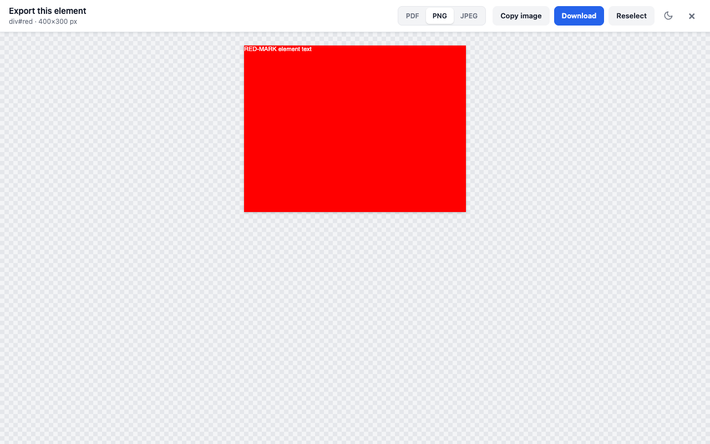

# Web Snap PDF

Web Snap PDF is a Chrome extension that saves the page you are reading as a PDF. It prints with
Chrome's own engine (`Page.printToPDF` through `chrome.debugger`), so the PDF keeps the page's
styles, the text stays selectable, and links stay clickable. You can save the whole page, only the
article, or one element you pick, and you can save that element as a PNG or JPEG image too. The
extension makes no network requests and needs no account.

Web Snap PDF is not on the Chrome Web Store. To use it, [install it from source](#install-from-source).
It needs Chrome 128 or newer.

| Popup                                                                                                       | Popup, dark theme                                                       |
| ----------------------------------------------------------------------------------------------------------- | ----------------------------------------------------------------------- |
|  |  |

After **Select element**, the page shows a preview of the element with export buttons at the top:

## What it does

- Saves the whole page, the main article, or one element you pick.
- Turns a picked element into a PDF, PNG, or JPEG. Images are 2× the element's size by default, and
  the options page offers 1×, 2×, or 3×. **Copy image** copies the preview, at screen resolution, and
  always puts a PNG on the clipboard, even when you choose JPEG.
- Lays out the PDF as normal pages or as one tall page. A single page stops at 200 inches, and
  longer content continues on another 200-inch page.
- Offers 22 paper sizes (A0 to A9, B0 to B5, Letter, Legal, Tabloid, Ledger, Folio, and Executive)
  in portrait or landscape, with margin presets of 0, 5, 10, or 20 mm or custom margins per side.
- Scales the page from 10 to 200 percent, or lays it out at a fixed width (1440, 1280, 1024, 768,
  or 375 px) and computes the scale from that.
- Adds a header and footer with the title, date, URL, and page numbers.
- Prints with the page's print or screen CSS, with or without backgrounds, and can limit the PDF to
  page ranges such as `1-3, 5`. Headings become PDF bookmarks.
- Prepares the page before printing. It scrolls to load lazy images, hides small fixed bars,
  un-sticks sticky headers, and expands inner scroll areas such as chat panes.
- Lets you click elements to remove them before saving, with undo and a reset that brings them back.
- Names files from a pattern with `{title}`, `{domain}`, `{date}`, and `{time}`.
- Has a right-click menu, two keyboard shortcuts, light and dark themes, and an interface in eight
  languages: English, Spanish, German, French, Brazilian Portuguese, Hindi, Japanese, and
  Simplified Chinese.
- Exports Markdown as an experimental option. It is off until you turn it on.

## Privacy and permissions

Chrome renders every PDF and image on your device, and the file goes to your downloads folder. The
extension has no server, no analytics, and no remote code. A PDF moves only between the extension's
own pages, through runtime messages and `chrome.storage.session`, which Chrome keeps in memory.

The extension stores your settings in `chrome.storage.sync`, so Chrome Sync copies them to your
other devices when sync is on. A few interface preferences, such as whether **Export settings** is
open, go to `chrome.storage.local`. The popup, options, and fallback pages also cache your theme in
the extension's own `localStorage`, so they can apply it before your settings load. The extension
never stores page content.

The manifest asks for no host permissions. The extension reaches a tab only after you use the
toolbar button, a menu entry, or a shortcut on that tab.

| Permission     | Why the extension needs it                                                                                                                                                                              |
| -------------- | ------------------------------------------------------------------------------------------------------------------------------------------------------------------------------------------------------- |
| `debugger`     | Calls Chrome's `Page.printToPDF` and full-element `Page.captureScreenshot`, which no other extension API reaches. The extension attaches to one tab for one export and detaches when the file is ready. |
| `activeTab`    | Gives temporary access to the tab you acted on, in place of host permissions.                                                                                                                           |
| `scripting`    | Injects the content script that prepares the page, runs the element picker and the preview, converts Markdown, and restores the page afterwards.                                                        |
| `downloads`    | Saves the file, through Chrome's Save As dialog if you turn on **Ask where to save each PDF**.                                                                                                          |
| `storage`      | Keeps your settings, and hands a PDF to a fallback download page if a direct download fails.                                                                                                            |
| `contextMenus` | Adds the right-click menu entries.                                                                                                                                                                      |

### Why Chrome says "started debugging this browser"

While the extension prints a PDF or captures an element, Chrome shows a bar that says _Web Snap PDF
started debugging this browser_. Chrome shows this bar for every extension that attaches
`chrome.debugger`, and no extension can hide it. The bar goes away when the export finishes. If you
click **Cancel** on the bar, the export stops. Markdown export does not use the debugger and shows
no bar.

## Install from source

1. Clone this repository, or download it as a ZIP file and unzip it.
2. Open `chrome://extensions` and turn on **Developer mode**.
3. Click **Load unpacked** and select the `extension/` folder, the one that contains
   `manifest.json`. Do not select the repository root.
4. Pin Web Snap PDF from the extensions menu so its toolbar button stays visible.

After you pull new changes, click the reload button on the extension's card in
`chrome://extensions`, then reload the tabs you want to save.

## Use it

### The popup

Click the toolbar button. The popup has three cards:

- **Full page** downloads the whole page as a PDF.
- **Article only** downloads the main content as a PDF, without menus, sidebars, or ads.
- **Select element** closes the popup and starts the element picker on the page.

Under the cards, **Remove elements** starts remove mode. Once you have removed something, **Reset
page** appears and brings it all back. **Layout** switches between page breaks and a single page,
and the line under it shows the settings the next PDF will use, for example
`A4 · Portrait · 10 mm margins · Backgrounds on`. **Export settings** holds the paper, margin,
scale, content, header and footer, and page range options. The popup saves each change as you make it.

### Select an element

Hover over the page to highlight an element. The up arrow key widens the selection to the parent
element, and the down arrow key narrows it. Click to select, or press Esc to cancel.

The page then shows a full-page preview of the element with a toolbar at the top. Choose PDF, PNG,
or JPEG and click **Download**, or click **Copy image** for PNG and JPEG. A PDF uses your saved
settings. **Reselect** picks another element, and **Close** or Esc closes the preview.

A tall element appears as numbered parts, one below the other. Each part has its own **Copy** and
**Download** buttons, and **Download all parts** in the toolbar saves every part. Chrome cannot
capture an image larger than 16,384 px on its longest side, so the extension scales down an element
that is too large for that limit, and the preview shows the scale it used.

### Remove elements

Click **Remove elements**, then click anything on the page, such as an ad or a cookie banner, to
hide it. The bar on the page has **Undo**, **Save PDF**, and **Done**. Removed elements stay hidden
until you reset or reload the page, and Markdown exports leave them out too.

### Export Markdown (experimental)

Turn on Markdown under **Experimental** on the options page. The popup then shows a **Markdown**
row with **Full page** and **Article**, and the element preview offers Markdown as a format. The
converter reads the live page and writes CommonMark with GFM tables. The file ends with a
`Source: <url>` line.

### Right-click menu and keyboard shortcuts

Right-click the page, a frame, or the toolbar icon to save the page or the article, pick an
element, remove elements, or restore removed ones. The menu entries are in English only.

| Shortcut      | Action                                 |
| ------------- | -------------------------------------- |
| `Alt+Shift+P` | Save the page with your saved settings |
| `Alt+Shift+A` | Save only the main article             |

To change the shortcuts, open `chrome://extensions/shortcuts`. The **Shortcuts** link in the popup
footer opens that page.

### Options page

The options page sets the theme and the interface language. It also sets the file name pattern,
with a live preview of the name the pattern produces. **Ask where to save each PDF** opens Chrome's
Save As dialog for every download, including images and Markdown files. **Image resolution** sets
PNG and JPEG exports to 1×, 2×, or 3× the element's size.

Under **Page handling**, the options page turns inner scroll area expansion on or off. It is on by
default. Another setting lets a page's `@page` CSS size override the paper size you chose. The page
also turns on Markdown export and resets all settings.

## Limitations

- Chrome does not let extensions run on `chrome://` pages, other extensions' pages, or the Chrome
  Web Store. The popup disables its cards on those pages.
- `file://` pages work only after you turn on **Allow access to file URLs** for the extension in
  `chrome://extensions`.
- Only one debugger can attach to a tab. If DevTools is open on the tab, close it and try again.
- The content script runs in the top frame only, so the extension does not prepare or convert the
  content of iframes.
- Article detection is a heuristic. If it picks the wrong block or finds none, use **Select
  element**.
- Canvas, WebGL, and video content prints as Chrome's print engine renders it.
- On very long pages, page scans stop after 200,000 elements and the wait for slow images ends after
  6 seconds. Auto-scroll moves through every page the same way, 50 ms per step, and always covers at
  least 250 steps. After that it stops as soon as the page has grown since step 250 (an endless
  feed), or after 30 seconds on a page that does not grow. The popup and the preview then warn that
  content near the end may be missing.
- Markdown export drops `data:` images larger than 2 KB, escapes Markdown punctuation everywhere
  (`snake_case` becomes `snake\_case`), and exports elements hidden with `visibility: hidden`. It
  has no support for rowspan, `sup`, `sub`, `mark`, `u`, task lists, or reversed lists. It merges
  list items that have several paragraphs into one.
- In Markdown tables, the first row is always the header row, a cell with `colspan` adds empty cells
  after it, and line breaks inside a cell become ` `. Markdown export skips closed shadow roots,
  because the content script cannot read them.

## Troubleshooting

| Message or symptom                                                                                                  | Fix                                                                                                                                                                                                                                                     |
| ------------------------------------------------------------------------------------------------------------------- | ------------------------------------------------------------------------------------------------------------------------------------------------------------------------------------------------------------------------------------------------------- |
| "Another tool (usually DevTools) is attached to this tab"                                                           | Close DevTools on that tab and try again.                                                                                                                                                                                                               |
| "Could not reach the page content. Reload the page and try again."                                                  | The tab was open before you installed or reloaded the extension. Reload the tab.                                                                                                                                                                        |
| "PDF generation was cancelled."                                                                                     | Someone clicked **Cancel** on the debugging bar, or the tab navigated or closed.                                                                                                                                                                        |
| "Could not detect an article on this page."                                                                         | Use **Select element** instead.                                                                                                                                                                                                                         |
| **Select an element to preview and save** or **Remove elements before saving** in the right-click menu does nothing | An export is still running on this tab. The extension refuses the entry and writes the reason only to the service worker console. While the export runs, the popup disables its cards and shows "Generating PDF…". Try again after the export finishes. |
| Images are missing from the PDF                                                                                     | Keep **Scroll page to load lazy images** on. Slow images get up to 6 seconds.                                                                                                                                                                           |
| "Stopped scrolling before the end of the page, so some content near the end may be missing."                        | The page kept growing as it scrolled past step 250 (an endless feed), or is too long to scroll in 30 seconds. Scroll down to load the part you need, then save again, or use **Select element** to save only that part.                                 |
| The page looks like a phone layout, or very small                                                                   | Change the layout width, or choose **Fit to paper width** and set the scale.                                                                                                                                                                            |
| The page looks wrong after a failed export                                                                          | Right-click the page and choose **Restore all removed elements**, or reload the tab. If you removed elements, **Reset page** in the popup does the same.                                                                                                |

## How it works

The service worker, `extension/src/background.js`, runs every export. It injects the content script,
`extension/src/content.js`, into the tab if the script is not there yet, and asks it to prepare the
page. The content script loads lazy images, isolates the article or the picked element, hides small
fixed bars, and un-sticks sticky ones. For a PDF, the service worker then attaches `chrome.debugger`,
calls `Page.printToPDF`, and downloads the result.

For an image, the service worker attaches the debugger before it prepares the page. Chrome's
debugging bar shrinks the viewport when it appears, and a `Page.captureScreenshot` taken while the
viewport changes size repeats the first viewport height of the element instead of the rest. The
service worker waits until the viewport stops changing size, then prepares the page and captures the
element.

In both cases, a `finally` block always detaches the debugger and tells the content script to
restore the page. If a direct download fails, the service worker opens a small fallback page with a
**Download** button.

Markdown export does not use the debugger. The content script converts the live page, and the
service worker downloads the text.

[docs/ARCHITECTURE.md](docs/ARCHITECTURE.md) describes each module, the `ps:*` messages between
them, storage, and the settings schema.

## Development

[CONTRIBUTING.md](CONTRIBUTING.md) covers setup, every test suite, and the verification skills. These
are the commands you use most:

| Command                | What it does                                                      |
| ---------------------- | ----------------------------------------------------------------- |
| `npm run check`        | Runs ESLint, the Prettier check, and the locale check.            |
| `npm test`             | Tests the PDF pipeline.                                           |
| `npm run test:content` | Tests the content script, the pickers, the preview, and Markdown. |
| `npm run test:ui`      | Renders the extension's pages in both themes and fails on errors. |
| `npm run package`      | Builds the ZIP file for the Chrome Web Store in `dist/`.          |

`npm run package` writes `dist/web-snap-pdf-<version>.zip` with `manifest.json` at the root of the
archive. It stops if `package.json` and `extension/manifest.json` have different versions, and it
needs the `zip` command. The release checklist is in [docs/RELEASE.md](docs/RELEASE.md).

## Contributing

To contribute, start with [CONTRIBUTING.md](CONTRIBUTING.md). It covers setup, the checks to run,
and what a good pull request contains. These open tasks need an owner:

- Translate the right-click menu entries, the fallback download page, and the remaining service
  worker error messages, which are in English only.
- Close the Markdown gaps listed under [Limitations](#limitations). The converter should handle
  rowspan, `sup`, `sub`, `mark`, `u`, task lists, reversed lists, and list items with several
  paragraphs. It should also skip `visibility: hidden` elements and escape less punctuation.
- Add a "Save selection as PDF" menu entry that saves the element that contains the selected text.
- Save every tab in the current window in one batch.
- Make the Chrome Web Store graphics, which are five 1280 × 800 screenshots on a realistic demo page
  and a 440 × 280 promo tile. [docs/RELEASE.md](docs/RELEASE.md) has the screenshot plan.

## License

Web Snap PDF is free software under the [MIT License](LICENSE).
